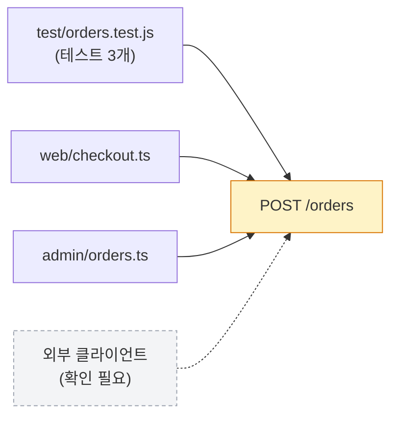

# 모듈: 서버 변경

서버 코드가 바뀌는 PR에 붙는다. 서버 리뷰어는 글을 읽기보다 **검증할 수 있는 증거**를 보고 싶어 한다. 그래서 이 섹션은 문장이 아니라 **증거 블록**(표, diff, 코드블록, 번호 목록)으로 쓴다. 블록 하나에 문장은 한 줄을 넘기지 않는다.

이 모듈은 코멘트나 외부 동작이 없고 본문 섹션만 쓴다.

## 감지

**강한 신호**가 하나라도 있으면 서버 모듈을 붙인다. 프로젝트마다 구조가 달라 틀릴 수 있으니 분류 결과는 항상 사용자에게 확인받는다.

- 경로: `server/` `backend/` `api/` `controllers/` `src/main/`
- 프레임워크 규약: `app/api/**`, `pages/api/**`, `route.ts`
- 파일명 규약(디렉터리가 아니라 파일명으로 구분하는 프레임워크): `*.controller.*` `*.module.*` `*.dto.*` `*.entity.*` `*.schema.*`/`*.schemas.*` (NestJS 등), `*Controller.java|kt` `*Repository.java|kt` (Spring), `views.py` `urls.py` `models.py` (Django)
- 데이터: `migrations/`, `*.sql`, `schema.prisma`, `db/`
- 계약: `openapi*`, `*.proto`, GraphQL 스키마(`*.graphql`)
- 설정: `.env.example`, `application*.yml`, 서버 설정 파일

**약한 신호**(`services/` `models/` `handlers/` `resolvers/` `repositories/` `routes/`)는 클라이언트 코드에도 흔하다(예: 프런트엔드가 외부 API를 부르는 `services/`). 약한 신호만 있으면 서버로 보지 않는다. 다만 "서버로 보이는지" 사용자에게 한 번 묻는다. 서버 런타임 단서(서버 프레임워크 의존성, 서버 진입점, 빌드 대상이 서버)가 diff에서 확인될 때만 약한 신호도 서버로 센다.

테스트 파일(`*.test.*`, `*.spec.*`)만 바뀐 경우는 제외한다.

## 본문 섹션

아래 블록을 이 순서로 쓰고, **해당 없는 블록은 통째로 삭제한다.** 빈 블록이나 "없음"만 적은 블록을 두지 않는다.

````markdown
## 서버 변경

| 영역 | 영향 | 비고 |
|---|---|---|
| API | 있음 / 없음 | 하위 호환: 호환 / **깨짐** / 확인 필요 |
| DB | 있음 / 없음 | 락·백필·롤백은 아래 |
| 설정 | 있음 / 없음 | |
| 배포 | 순서 의존 있음 / 없음 | |

### API 계약

```diff
 POST /orders
 request
+  couponId?: string
 response 201
-  total: number
+  total: { amount: number, currency: string }
```

### 호출 결과

```bash
curl -s -X POST localhost:3000/orders -d '{"items":[1],"couponId":"C1"}'
```
<details><summary>응답 (before / after)</summary>

```json
// before
{ "id": 1, "total": 12000 }
// after
{ "id": 1, "total": { "amount": 12000, "currency": "KRW" } }
```
</details>

### 영향 범위



### 마이그레이션

```sql
ALTER TABLE orders ADD COLUMN coupon_id VARCHAR(36) NULL;
```

| 락 | 백필 | 롤백 |
|---|---|---|
| 없음 (NULL 허용 컬럼 추가) | 불필요 | 가능 (`DROP COLUMN`) |

### 설정

| 이름 | 기본값 | 필수 | 읽는 곳 |
|---|---|---|---|
| `COUPON_API_URL` | — | 예 | `src/coupon/client.ts` |

### 배포 순서

1. 마이그레이션 실행
2. 서버 배포
3. 플래그 `coupon_enabled` on

### 검증

```text
$ npm test -- orders
 ✓ POST /orders applies coupon (4 tests)
```
````

## 채우는 규칙

- **요약 표가 맨 위다.** 리뷰어가 이 표만 보고 어디를 깊게 볼지 정할 수 있어야 한다. 표의 "없음" 행은 남겨도 된다(나머지 블록은 삭제).
- **그림은 기본으로 넣지 않는다.** diff와 표로 이미 읽히는 내용을 색만 입혀 다시 그리는 것은 정보가 아니다. 그림은 **diff만으로는 보이지 않는 것**을 보여줄 때만 쓴다. 아래 둘 중 하나일 때다:
  1. **영향 범위 그래프** (`### 영향 범위`) — 이 PR이 바꾼 엔드포인트·함수를 **레포 안에서 누가 호출하는지**.
     - 호출자는 추측하지 말고 **코드 검색으로 찾은 것만** 그린다 (엔드포인트 경로 문자열, 바뀐 함수·클래스 이름으로 검색). 테스트는 `테스트 N개`로 묶는다.
     - 호출자가 **3곳 미만이면 그림을 생략**하고 한 줄로 쓴다: "레포 내 호출자: 테스트 1개. 외부 클라이언트는 확인 필요".
     - 레포 밖 클라이언트는 검색으로 알 수 없으므로 점선 노드 `외부 클라이언트 (확인 필요)`로만 표시한다. 있다고 단정하지 않는다.
     - 노드는 10개 안쪽. 바뀐 대상은 `:::changed`(주황), 모르는 것은 `:::unknown`(회색 점선).
  2. **스키마 트리** — 요청·응답 변경 필드가 **8개 이상**이거나 중첩 깊이가 **3 이상**이라 diff가 읽기 어려울 때만. 추가 `:::added`(초록), 삭제 `:::removed`(빨강), 의미 변경 `:::changed`(주황). 요청과 응답은 `subgraph`로 나누고 `req ~~~ res`로 요청이 왼쪽에 오게 한다. 변경된 경로 위주로 그린다.
  - 공통: 라벨은 항상 `"큰따옴표"`로 감싼다(`?`, `:`, `[]`가 문법을 깨뜨린다). 줄바꿈은 `<br/>`. 문법이 확실하지 않으면 그림을 생략한다 — 깨진 그림은 없는 그림보다 나쁘다.
- **증거는 diff와 실제 실행에서만.** 엔드포인트·필드·컬럼 이름은 코드에서 확인된 것만 적는다.
- **호출 결과와 검증 로그는 이 세션에서 실제로 실행한 것만** 붙인다. 실행하지 않았으면 블록을 지우고 요약 표 아래에 "호출 검증 안 함"이라고 한 줄 쓴다. 응답을 지어서 쓰지 않는다. 호출하려면 부작용(쓰기 요청, 외부 호출)이 안전한 환경인지 먼저 사용자에게 확인한다.
- **하위 호환·락·백필·롤백·배포 순서는 diff로 단정하기 어렵다.** 확신이 없으면 값을 추측해서 채우지 말고 "확인 필요: <무엇>"으로 적어 사용자에게 묻는다. 필드 삭제·타입 변경·NOT NULL 추가·인덱스 생성 같은 깨지는/무거운 변경 신호가 보이면 해당 칸을 "**깨짐 가능성**" 또는 "락 가능성"으로 먼저 짚는다.
- **마이그레이션은 SQL 원문**을 넣고, 데이터를 지우거나 덮어쓰면 `## 리뷰 포인트`에도 올린다.
- **성능 수치는 측정한 것만.** `EXPLAIN` 결과나 벤치마크를 실제로 돌렸을 때만 쓴다. 측정하지 않은 성능 개선·악화 주장은 쓰지 않는다.
- **비밀 값은 쓰지 않는다.** 환경변수는 이름만 적는다. 값, 토큰, 접속 문자열, 키는 응답 예시·로그 안에서도 가린다(`***`).
- **`## 테스트`**는 위 `### 검증`에 붙인 것과 일치하는 내용만 적는다.
